# Codecaine MLX RAD AI Audio Studio — Complete Production Tutorial & Reference Manual

<p align="center">
  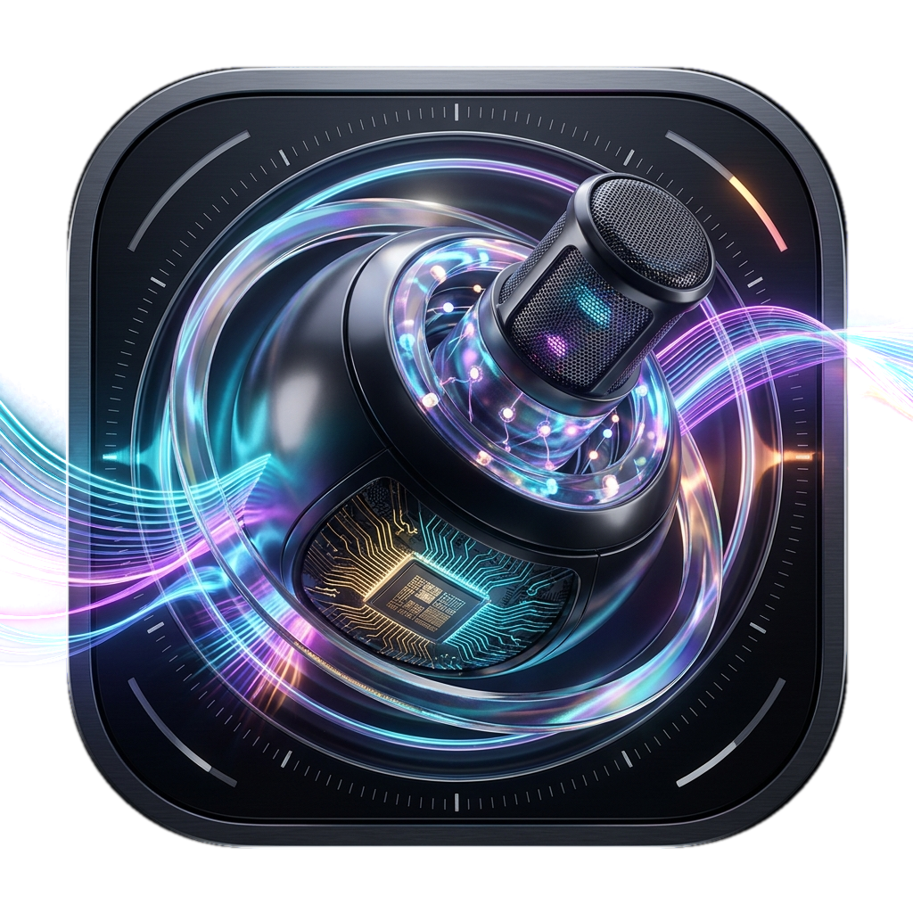
</p>

**Author:** Codecaine (`@codecaine-zz`)  
**Platform:** macOS 15+ (Apple Silicon M1 / M2 / M3 / M4)  
**Engine:** Native Swift 6 + Apple MLX Metal Neural Engine  
**License:** MIT License  

---

## Table of Contents

1. [Overview & System Architecture](#1-overview--system-architecture)
2. [Installation & Building from Source](#2-installation--building-from-source)
3. [Tab 1: Voice Studio — Neural TTS, 41 Studio Voices & Zero-Shot Cloning](#3-tab-1-voice-studio--neural-tts-41-studio-voices--zero-shot-cloning)
4. [Live Read-Along Karaoke Stage & 6 Studio Cinema Themes](#4-live-read-along-karaoke-stage--6-studio-cinema-themes)
5. [Large Book / EPUB Studio, 2-Second Synthesis & Direct Silent Export](#5-large-book--epub-studio-2-second-synthesis--direct-silent-export)
6. [Tab 2: Transcribe Studio — Phonon 2.5 ASR, Diarization & Real Song Lyrics Extractor](#6-tab-2-transcribe-studio--phonon-25-asr-diarization--real-song-lyrics-extractor)
7. [Tab 3: Audio Lab — Speech-to-Speech, Stem Isolation & Neural Denoising](#7-tab-3-audio-lab--speech-to-speech-stem-isolation--neural-denoising)
8. [Tab 4: Localhost API Server (`:8080`, Ollama `:11434`, LM Studio `:1234`) & 70% RAM Guard](#8-tab-4-localhost-api-server-8080-ollama-11434-lm-studio-1234--70-ram-guard)
9. [Tab 5: Packages — 1-Click Homebrew & 13 Studio Media Tools](#9-tab-5-packages--1-click-homebrew--13-studio-media-tools)
10. [Swift SDK & CLI Integration Guide](#10-swift-sdk--cli-integration-guide)
11. [Keyboard Shortcuts, URL Schemes & Troubleshooting](#11-keyboard-shortcuts-url-schemes--troubleshooting)

---

## 1. Overview & System Architecture

**Codecaine MLX RAD AI Audio Studio** (`VoicesApp.app`) is an all-in-one, local-first Apple Silicon AI Audio Workstation built natively in SwiftUI and powered by Apple's **MLX Metal framework**. Every neural network runs 100% locally on your Mac's Unified Memory GPU with zero cloud latency, zero API fees, and complete privacy.

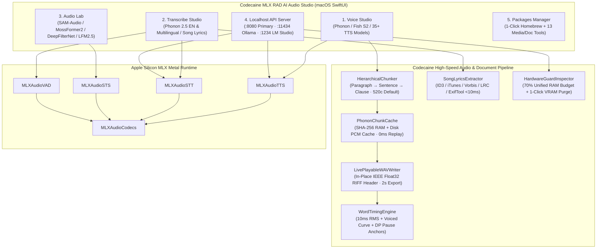

### Core Engineering Highlights

| Subsystem | What It Does | Latency / Complexity |
| :--- | :--- | :--- |
| **Default TTS Engine** | `nativ-community/phonon` (`Freya`, `Harper`, `Sterling`, `Toby` + custom clones) | **~1.5–2.0s** first chunk synthesis |
| **Default STT Engine** | `FermionResearch/Phonon-2.5-English` + 1-click toggle to `Phonon-2.5` Multilingual | Real-time streaming + 25s windowed full-song ASR |
| **Direct Silent Export** | Export `WAV`, `MP3`, `M4A`, `FLAC`, `AIFF`, `.MP4` Video, or `.SRT`/`.VTT`/`.ASS` **without pressing Generate Speech or playing sound** | **~1.5–2.0s** per chunk (`0ms` when cached) |
| **Focused Stage Karaoke** | Centers the active spoken chunk (`§N`) with `↑ Prev` / `↓ Next` context bars so highlighted words never scroll off screen | $O(\log N)$ binary search word lookup |
| **Real Song Lyrics Extractor** | Reads embedded ID3/iTunes/Vorbis/RIFF lyrics & `.lrc`/`.srt`/`.txt` sidecars before running AI ASR | **< 10 ms** instant extraction |

---

## 2. Installation & Building from Source

### Option A: Download Prebuilt macOS Release (Recommended for Users)

1. Download the latest release archive from the [**GitHub Releases**](https://github.com/codecaine-zz/mlx-audio-swift/releases) page:
   - `Codecaine-MLX-Audio-Studio-v1.0.0-macOS-arm64.dmg` (Drag-and-drop macOS Disk Image)
   - `Codecaine-MLX-Audio-Studio-v1.0.0-macOS-arm64.zip` (Portable zipped application bundle)
   - `Codecaine-MLX-Audio-Studio-Complete-Video-Tutorial.mp4` (1080p HD Video Tutorial narrated by AI Phonon MLX)
2. Drag **`Codecaine MLX RAD AI Audio Studio.app`** (or `VoicesApp.app`) to `/Applications`.
3. **Important Note for Unsigned macOS Apps (Gatekeeper Quarantine)**: Because the release binary is ad-hoc signed without a paid Apple Developer ID certificate, macOS Gatekeeper attaches a `com.apple.quarantine` extended attribute to downloaded apps. Before opening the app for the first time, run this command in **Terminal**:
   ```bash
   xattr -dr com.apple.quarantine "/Applications/Codecaine MLX RAD AI Audio Studio.app"
   open "/Applications/Codecaine MLX RAD AI Audio Studio.app"
   ```
   *(If your bundle is named `VoicesApp.app`, run `xattr -dr com.apple.quarantine /Applications/VoicesApp.app`)*
   ```

### Option B: Build from Source with Xcode / `xcodebuild`

> **Important (Apple Silicon Metal Shaders):** Always build with Xcode or `xcodebuild` so the Metal shader library (`default.metallib` / `mlx.metallib`) is compiled and bundled inside `VoicesApp.app`.

```bash
git clone https://github.com/codecaine-zz/mlx-audio-swift.git
cd mlx-audio-swift

# Build Release app bundle for Apple Silicon macOS
xcodebuild \
  -project Examples/VoicesApp/VoicesApp.xcodeproj \
  -scheme VoicesApp \
  -configuration Release \
  -destination 'platform=macOS' \
  CODE_SIGNING_ALLOWED=NO \
  build
```

---

## 3. Tab 1: Voice Studio — Neural TTS, 41 Studio Voices & Zero-Shot Cloning

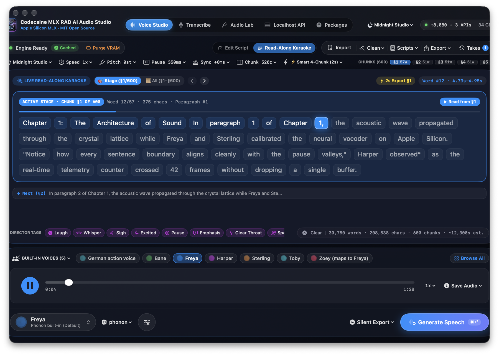

**Voice Studio** is your primary speech synthesis, book narration, voice cloning, and karaoke video production workspace.

### 3.1 Selecting a Neural TTS Engine
Click the **Model Engine Capsule** (`phonon ⌄`) in the bottom dock to switch between **35+ local MLX TTS models**:
- **Phonon MLX (Default · `nativ-community/phonon`)**: Ultra-fast, hyper-natural English & multilingual voices (`Freya`, `Harper`, `Sterling`, `Toby`).
- **Phonon 40M / 31M Family**: Dedicated checkpoints for English, Multilingual, French, German, Spanish, and Portuguese.
- **Fish Audio S2 Pro (`8-bit` & `BF16`)**: Expressive zero-shot and multi-character studio synthesis with 41 curated presets.
- **Qwen3-TTS (`0.6B` & `1.7B` Base / CustomVoice / VoiceDesign)**: Supports natural-language **Voice Design** prompts (e.g., *"A warm, calm British documentary narrator"*).
- **Kokoro 82M, Orpheus 3B, VibeVoice Realtime, Voxtral 4B TTS, Spark-TTS, ZONOS2, Dia 1.6B, OuteTTS, Higgs Audio v2/v3, Marvis TTS, Pocket TTS**.

### 3.2 Browsing Built-In Voices & Zero-Shot Voice Cloning

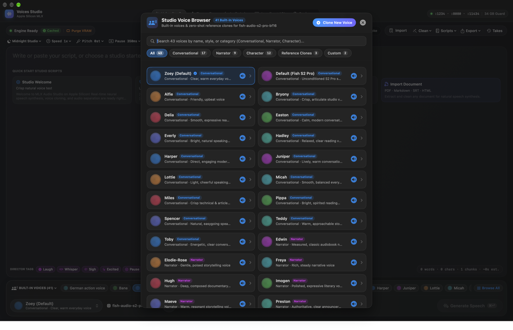

1. **Quick Voice Strip**: Use the horizontal voice strip in the bottom dock or click **`BUILT-IN VOICES ⌄`** to pick from voices grouped by:
   - **Conversational** (`Freya`, `Harper`, `Zoey`, `Maya`, `Chloe`, `Liam`, `Noah`...)
   - **Narrator** (`Sterling`, `Toby`, `Arthur`, `Eleanor`, `Julian`...)
   - **Character** (`Bane`, `German action voice`, `Cyberpunk AI`, `Wizard`...)
   - **Reference Clones** & **Custom Cloned Voices**
2. **Cloning Any Voice in Zero-Shot Mode**:
   - Click **`Browse All`** (or the active voice card in the bottom-left dock) to open the **Voice Browser & Cloner** sheet.
   - Click **`+ Clone New Voice`**.
   - **Upload an Audio File** (`.wav`, `.mp3`, `.m4a`, `.flac` — 5 to 15 seconds of clean speech is ideal) or **Record Live from Microphone**.
   - The app automatically analyzes the voice's **Acoustic Biometrics** (`F0` pitch in Hz, vocal register, spectral centroid brightness, and SNR dB) and transcribes the reference audio so your new cloned voice is ready immediately.

### 3.3 Prosody, Speed, Pitch & Performance Director Tags
- **Speed (`0.5x` – `2.0x`)**: Adjusts real-time `AVAudioUnitTimePitch` playback rate without altering pitch.
- **Pitch (`-6st` to `+6st`)**: Shifts voice pitch in semitones (`0st` = natural pitch) without changing speaking speed.
- **Pause (`0ms` – `2000ms`)**: Controls the exact silence duration inserted between paragraphs/chunks (`350ms` default).
- **Sync (`-200ms` to `+200ms`)**: Fine-tunes Read-Along Karaoke word highlight lead/lag (`0ms` Auto RMS Sync default).
- **Director Tags Bar**: Click any pill at the bottom of the script canvas (`[laugh]`, `[whisper]`, `[sigh]`, `[excited]`, `[pause]`, `[emphasis]`, `[clear_throat]`, `[S1]`, `[S2]`) to insert inline performance cues into your script.

---

## 4. Live Read-Along Karaoke Stage & 6 Studio Cinema Themes

Switch between **`Edit Script`** and **`Read-Along Karaoke`** in the top studio bar (or leave **Auto-Open Read-Along When Playing** enabled so it opens automatically when speech starts).

### 4.1 Why Highlighted Text Never Scrolls Off Screen (`Focused Stage Mode`)
When reading a multi-chunk document or a 600-chunk EPUB book, **Read-Along Karaoke** defaults to **Focused Stage Mode (`🎯 Stage (§1/600)`)**:
- **Top Context Bar (`↑ Prev (§N-1)`)**: Shows a 1-line preview of the previous chunk; click it to jump back one chunk.
- **Center Active Stage Card (`ACTIVE STAGE · CHUNK §N OF §TOTAL`)**: Displays only the words of the currently spoken chunk (`~50–90` words for a `520`-character chunk) with large, high-contrast word pills, a live progress bar (`Word X/Y · chars · Paragraph #`), and a `▶ Read from §N` button. Because the active chunk fits comfortably inside the stage card, **the highlighted blue word stays centered in view and never scrolls away**.
- **Bottom Context Bar (`↓ Next (§N+1)`)**: Shows a 1-line preview of the upcoming chunk; click it to advance immediately.
- **All-Chunks Mode (`📜 All (§1–§600)`)**: Prefer to see the entire document at once? Click `📜 All` in the teleprompter header. Distinct string IDs (`"chunk-\(cIdx)"` vs `"word-\(item.id)"`) ensure smooth word-centered scrolling without ID collisions.

### 4.2 How Waveform-Synced Word Timing Works (`WordTimingEngine`)

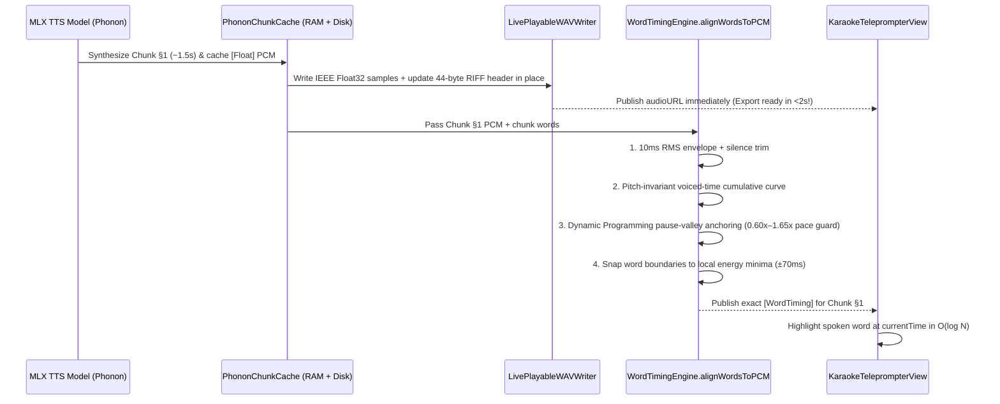

### 4.3 Six Built-In Studio Cinema Themes
Click the **Theme Picker (`Midnight Studio ⌄`)** in the top-right titlebar or prosody ribbon to switch the entire workspace and Read-Along Karaoke stage between 6 hand-crafted themes:

| Theme | Palette Style | Screenshot Preview |
| :--- | :--- | :--- |
| **Midnight Studio** | Deep slate glass with electric blue active word pills |  |
| **Daylight Paper** | Warm ivory editorial paper with cobalt blue highlights | 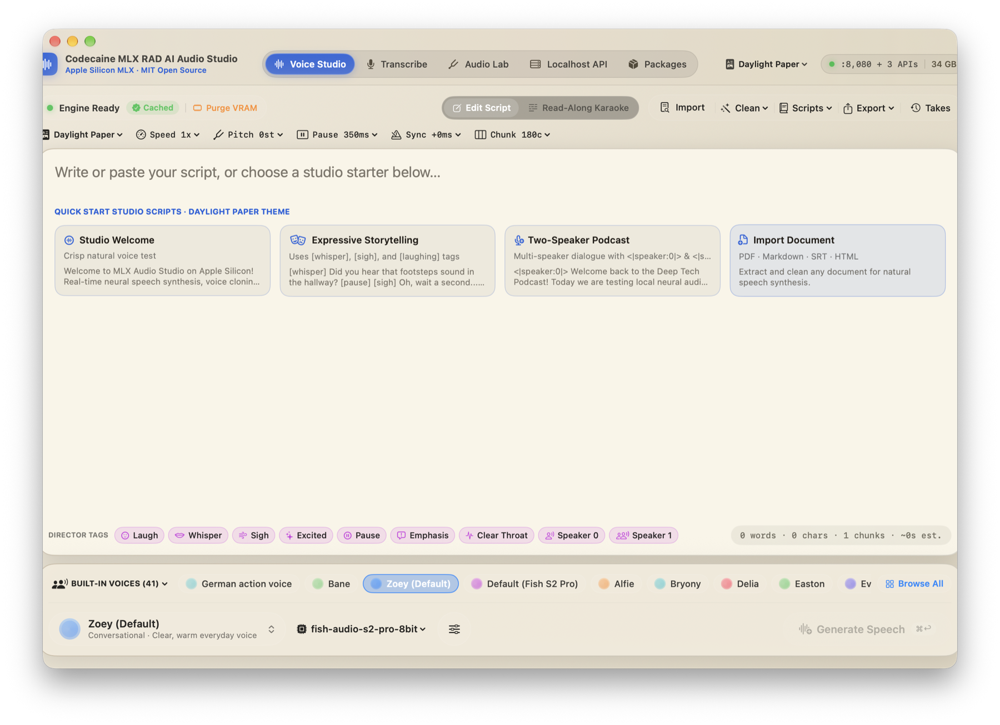 |
| **Warm Sepia** | Classic e-reader parchment with amber-gold highlights | 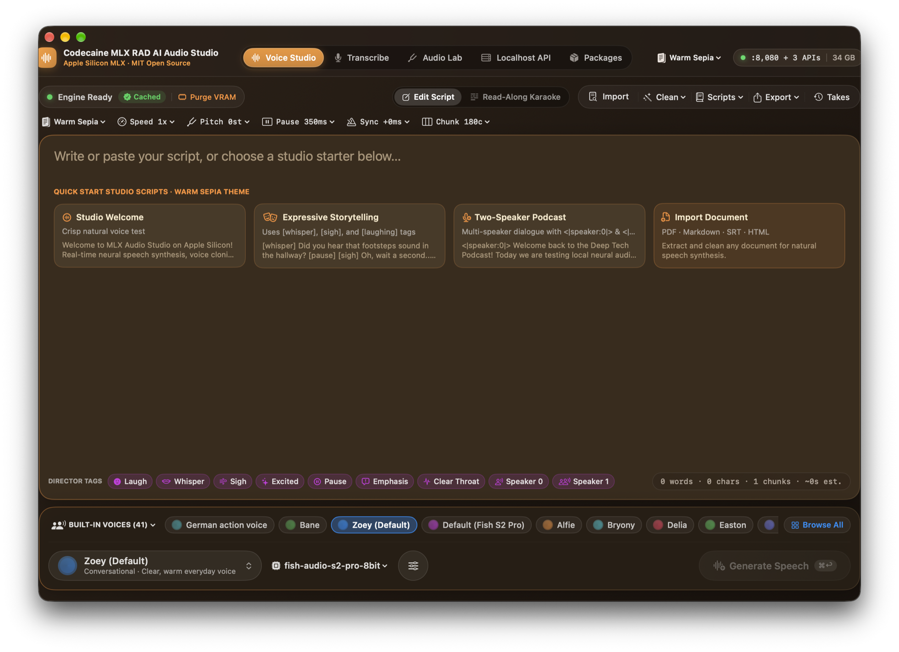 |
| **Matrix Green** | Phosphor terminal black with neon emerald highlights | 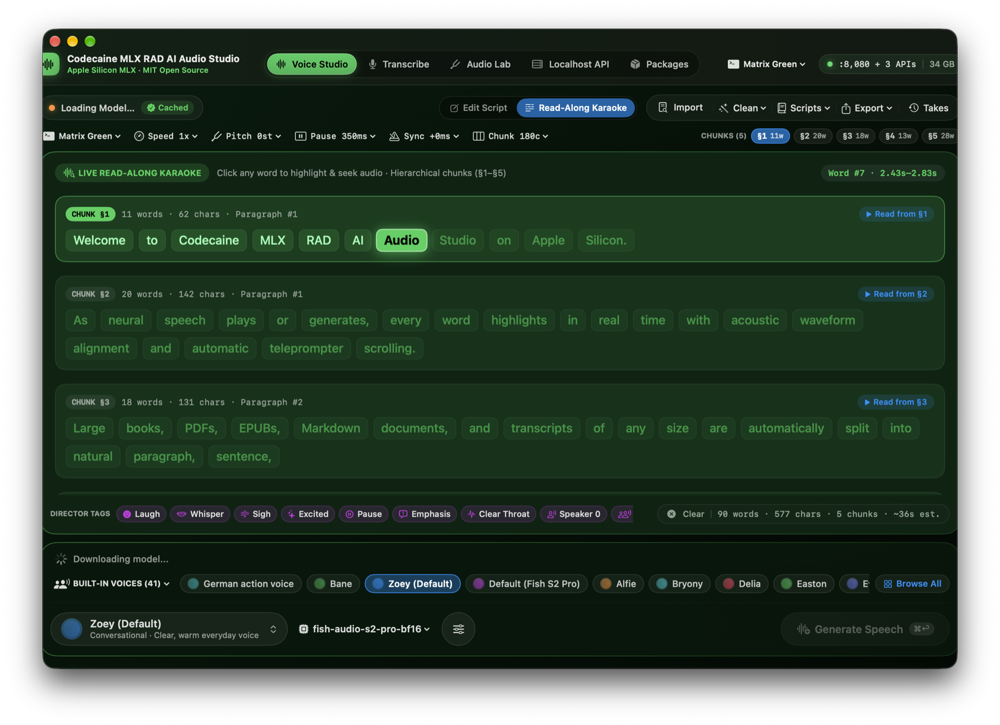 |
| **High Contrast** | Pure black stage with high-visibility golden yellow pills | Built-in accessibility preset |
| **Arctic Nord** | Frosty Nordic slate with cyan-ice highlights | Built-in dark preset |

---

## 5. Large Book / EPUB Studio, 2-Second Synthesis & Direct Silent Export

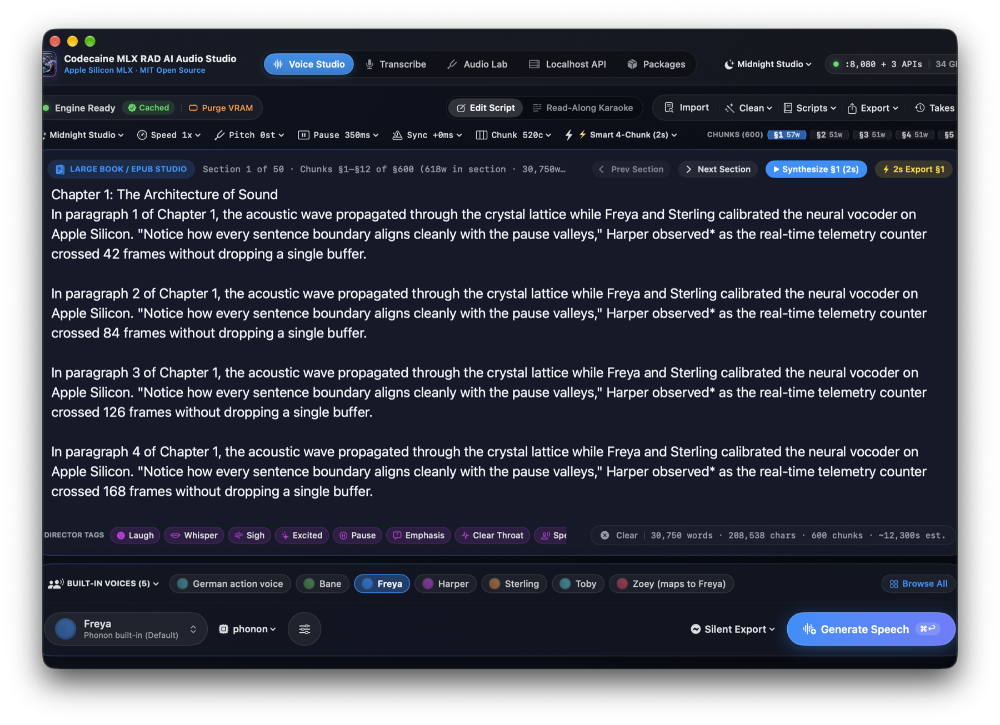

### 5.1 Importing EPUBs, PDFs, DOCX & Any Document
Click **`Import`** in the top action bar (or drag and drop a file onto the script canvas) to extract clean, speech-ready text from:
- **E-Books & Documents**: `.epub`, `.pdf`, `.docx`, `.odt`, `.rtf`, `.txt`, `.md`, `.html`
- **Subtitles & Data**: `.srt`, `.vtt`, `.ipynb` (Jupyter Notebooks), `.csv`, `.tsv`, `.json`
- **Images (OCR)**: `.png`, `.jpg`, `.tiff`, `.webp` (via Vision / Tesseract OCR)

For large books (`> 20,000` characters), **Voice Studio** automatically activates **Large Book / EPUB Studio** paged section editing (`12` chunks per section) so macOS `NSTextView` stays 100% responsive even on 500,000-character novels.

### 5.2 Smart 2-Second Synthesis Scope (`⚡ Smart 4-Chunk (2s)`)
Click the **`⚡ Smart 4-Chunk (2s) ⌄`** pill in the prosody ribbon to choose how large documents synthesize:
1. **`⚡ Smart Lookahead (2s Start + 4-Chunk Window)` (Default)**:
   - Synthesizes **Chunk `#1` (`§N`) in ~1.5–2.0 seconds**, immediately starts audio playback with live Read-Along Karaoke highlighting, and immediately finalizes `audioURL` on disk so **Export is ready in 2 seconds**, while prefetching the next 3 chunks (`§N+1 .. §N+3`) in the background.
2. **`🎯 Active Chunk Only (~2s Instant)`**:
   - Synthesizes only the currently selected chunk (`§N`) in **~1.5–2.0 seconds** (`0 ms` if already in `PhononChunkCache`).
3. **`📚 Full Book / Document Batch`**:
   - Synthesizes all chunks from `§N` to the end of the book with `O(1)` memory overhead (`Memory.clearCache()` after each chunk).

### 5.3 Exporting Directly Without Pressing `Generate Speech` (Silent Export — No Sound Played)
You **never** have to press `Generate Speech` or listen to audio out loud just to export a file:
- **Bottom Dock `Silent Export ⌄` Button** (right next to `Generate Speech`):
  - **Direct Silent Audio Export**: Export as `.WAV`, `.M4A`, `.AIFF`, `.FLAC`, or `.MP3`. Opens the Save dialog immediately, synthesizes silently in the background (`playAudio: false` — **zero sound played through your speakers**), and writes the file.
  - **Instant 2s Active Chunk (`§N`) Silent Export**: Exports the active chunk (`§N`) as `WAV`, `MP3`, or `M4A` in ~2 seconds silently.
  - **Export Full Document as `WAV` / `MP3` / `M4A` (Silent)**: Renders the entire book/document silently to disk.
  - **Export Read-Along Karaoke Video (`.MP4` — `16:9`, `9:16`, `1:1`)**: Automatically synthesizes silently if needed and renders an H.264 `.mp4` karaoke video with word-by-word highlighting in your chosen theme.
- **One-Click `⚡ 2s Export §N` Pill**: Located directly inside the **Large Book / EPUB Studio** bar and the **Read-Along Karaoke** header for 1-click silent WAV export of the current chunk.

---

## 6. Tab 2: Transcribe Studio — Phonon 2.5 ASR, Diarization & Real Song Lyrics Extractor

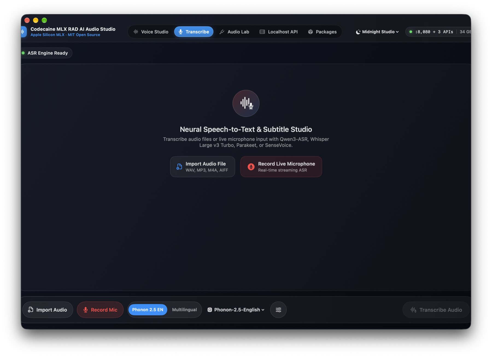

Switch to the **`Transcribe`** tab in the top navigation bar for Speech-to-Text (ASR), 4-speaker diarization, and instant song lyrics extraction.

### 6.1 Default Phonon 2.5 English & Multilingual Toggle
- **Default Model**: **`Phonon 2.5 English` (`FermionResearch/Phonon-2.5-English`)** is pre-configured out of the box.
- **1-Click Segmented Toggle**: Switch between **`Phonon 2.5 EN`** and **`Multilingual`** (`FermionResearch/Phonon-2.5`) directly in the Transcribe header bar, or open the **ASR Model Picker** to choose `Whisper Large v3 Turbo`, `Parakeet TDT 0.6B v3`, `Qwen3-ASR 1.7B`, `Voxtral Mini`, `SenseVoice`, or `Cohere Transcribe`.
- **Speaker Diarization (`Sortformer`)**: Enable speaker diarization to label multi-speaker conversations (`Speaker 1`, `Speaker 2`, etc.) with exact timestamps.

### 6.2 Automatic Real Song Lyrics Extraction (`SongLyricsExtractor`)

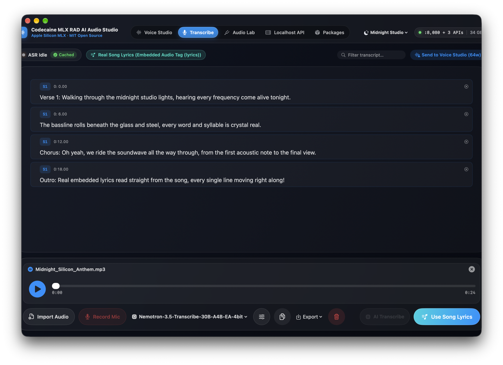

When you import or drag-and-drop any song file (`.mp3`, `.m4a`, `.flac`, `.wav`, `.aiff`), **Transcribe Studio** automatically checks for **real human-authored lyrics** before running AI speech recognition:
1. **Sidecar Lyric Files**: Checks for matching `.lrc`, `.srt`, `.vtt`, or `.txt` files next to the audio file.
2. **AVFoundation & AudioToolbox Metadata**: Inspects ID3v2 (`USLT` unsynchronized lyrics, `SYLT` synchronized lyrics), iTunes/MP4 (`©lyr`), and Vorbis/FLAC (`LYRICS`, `UNSYNCEDLYRICS`).
3. **Direct Binary Tag & RIFF INFO Scanner**: Scans raw ID3v2 frames (`USLT`), Vorbis comments, and WAV `RIFF/INFO` chunks (`ILYR`, `ICMT`, `iXML`) in `< 10 ms`.
4. **CLI Fallback (`ffprobe` / `exiftool`)**: Extracts custom lyric tags if installed.
- When embedded/sidecar lyrics are found, a green **`Embedded Song Lyrics Loaded`** banner appears immediately in `< 10 ms`! You can still click **`Force AI Audio Transcribe`** anytime if you want acoustic ASR instead.
- Clicking **`Send to Voice Studio`** transfers **100% of the full song lyrics or multi-window transcript** directly into Voice Studio for resynthesis or Read-Along Karaoke.

---

## 7. Tab 3: Audio Lab — Speech-to-Speech, Stem Isolation & Neural Denoising

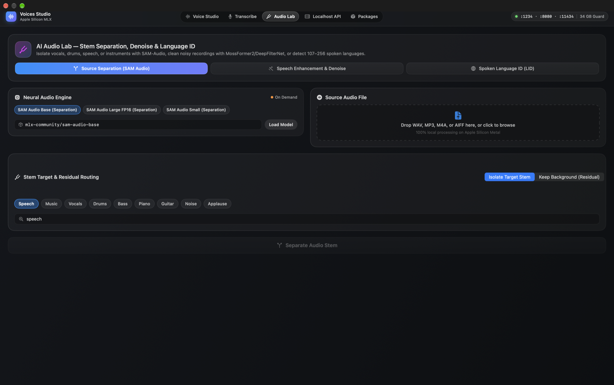

Switch to the **`Audio Lab`** tab for advanced Speech-to-Speech (STS) transformations, text-guided source separation, and studio mastering:

1. **SAM-Audio Text-Guided Stem Isolation (`mlx-community/sam-audio-large-fp16`)**:
   - Type any natural-language sound description (e.g., `"lead vocals"`, `"acoustic guitar"`, `"background traffic"`, `"drums"`) to isolate both the **Target Audio** and the **Residual Background** into separate playable/exportable tracks.
2. **Neural Speech Denoising & Enhancement**:
   - **MossFormer2-SE (`starkdmi/MossFormer2-SE-fp16`)** and **DeepFilterNet (`mlx-community/DeepFilterNet-mlx`)** remove room reverb, fan noise, hiss, and background chatter from recordings in seconds.
3. **LFM2.5-Audio Speech-to-Speech & Acoustic Description (`mlx-community/LFM2.5-Audio-1.5B-6bit`)**:
   - Converse directly with an audio-native language model or generate detailed acoustic/musical analyses of any imported audio clip.

---

## 8. Tab 4: Localhost API Server (`:8080`, Ollama `:11434`, LM Studio `:1234`) & 70% RAM Guard

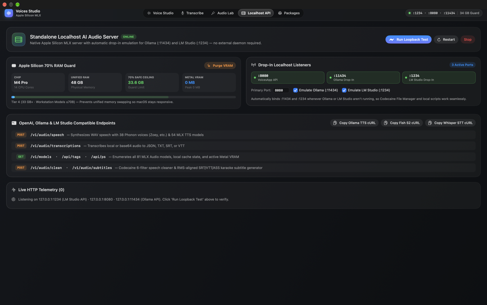

**Codecaine MLX RAD AI Audio Studio** includes a zero-configuration, multi-port HTTP server (`LocalhostServerManager`) that starts automatically when the app launches:
- **Primary Studio Port**: `http://127.0.0.1:8080`
- **Ollama Compatible Port**: `http://127.0.0.1:11434` (automatically binds if native Ollama is not occupying `:11434`)
- **LM Studio Compatible Port**: `http://127.0.0.1:1234` (automatically binds if LM Studio is not occupying `:1234`)

### 8.1 Apple Silicon 70% Unified Memory Hardware Guard
- Displays your Mac's chip (`Apple M1/M2/M3/M4`), total Unified RAM, safe **70% MLX Allocation Budget**, and live active Metal GPU memory.
- Click **`Purge VRAM (keep_alive: 0)`** in the top ribbon or Localhost API tab (or pass `"keep_alive": 0` in any API request) to immediately unload models and free 100% of Metal GPU memory.

### 8.2 Complete REST API Endpoints & Examples

#### 1. OpenAI-Compatible Text-to-Speech (`POST /v1/audio/speech`)
```bash
curl -X POST http://127.0.0.1:8080/v1/audio/speech \
  -H "Content-Type: application/json" \
  -d '{
    "model": "nativ-community/phonon",
    "input": "Hello from Codecaine MLX Audio Studio running locally on Apple Silicon!",
    "voice": "freya",
    "speed": 1.0
  }' \
  --output speech.wav
```

#### 2. OpenAI-Compatible Speech-to-Text (`POST /v1/audio/transcriptions`)
```bash
curl -X POST http://127.0.0.1:8080/v1/audio/transcriptions \
  -H "Content-Type: application/json" \
  -d '{
    "model": "FermionResearch/Phonon-2.5-English",
    "file": "/absolute/path/to/audio.wav"
  }'
```

#### 3. List Available Voices & Models (`GET /v1/audio/voices`, `GET /v1/models`, `GET /api/tags`)
```bash
curl http://127.0.0.1:8080/v1/audio/voices
curl http://127.0.0.1:8080/v1/models
curl http://127.0.0.1:8080/health
```

#### 4. Python OpenAI SDK Drop-In Example
```python
from pathlib import Path
from openai import OpenAI

client = OpenAI(base_url="http://127.0.0.1:8080/v1", api_key="mlx-local")

response = client.audio.speech.create(
    model="nativ-community/phonon",
    voice="freya",
    input="Synthesized in two seconds with Codecaine MLX Audio Studio."
)
response.stream_to_file(Path("output.wav"))
```

---

## 9. Tab 5: Packages — 1-Click Homebrew & 13 Studio Media Tools

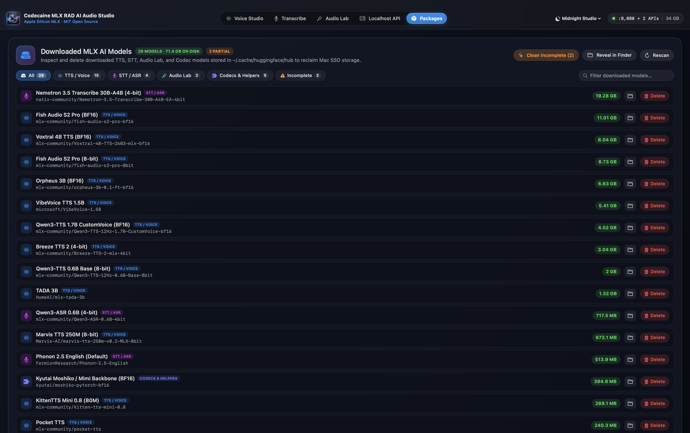

The **`Packages`** tab inspects your Mac's media and document processing toolchain and lets you install or upgrade everything in one click:
- **Homebrew Bootstrapper**: If Homebrew (`brew`) is not installed, click **`Install Homebrew in Terminal`** to launch an automated Terminal installer script.
- **1-Click `Install All Missing Core Tools`**: Automatically installs core studio dependencies (`ffmpeg`, `pandoc`, `poppler`, `imagemagick`) with live console progress.
- **13 Supported Packages**:
  1. **FFmpeg (`ffmpeg`)** — Universal audio/video encoding (`.mp3`, `.m4a`, `.flac`, Read-Along `.mp4`)
  2. **Pandoc (`pandoc`)** — Universal document conversion (`.docx`, `.odt`, `.epub`, `.rtf`, `.ipynb`, `.tex`)
  3. **Poppler (`pdftotext`)** — High-speed multi-column PDF text extraction
  4. **ImageMagick (`magick`)** — Cover artwork & thumbnail processing
  5. **Ghostscript (`gs`)** — PDF rendering and restructuring
  6. **Tesseract OCR (`tesseract`)** — Scanned document & image OCR across 100+ languages
  7. **qpdf (`qpdf`)** — Lossless PDF splitting and decryption
  8. **ExifTool (`exiftool`)** — ID3, Vorbis, FLAC, MP4, and EXIF metadata inspection
  9. **7-Zip (`7zz`)** — `.7z`, `.rar`, `.iso`, `.zip` archive extraction
  10. **The Unarchiver (`unar`)** — Legacy archive extraction
  11. **Ollama (`ollama`)** — Local LLM daemon integration
  12. **Calibre (`ebook-convert`)** — E-Book conversion (`.epub`, `.mobi`, `.azw3`, `.pdf`)
  13. **LibreOffice (`soffice`)** — Legacy Office document conversion (`.doc`, `.ppt`, `.xls`)

---

## 10. Swift SDK & CLI Integration Guide

In addition to the desktop application, this repository provides a modular Swift Package (`Package.swift`) with 7 libraries and 3 CLI tools:

### Swift Package Libraries
- `MLXAudioCore` — Audio I/O (`loadAudioArray`, `saveAudioArray`, `StreamingWAVWriter`), resampling, DSP utilities
- `MLXAudioCodecs` — `SNAC`, `Encodec`, `Vocos`, `Mimi`, `DACVAE`, `DescriptDAC`, `FishS1DAC`, `S3TokenizerV2`, `MiMoAudioTokenizer`, `NemotronVoiceChatCodec`, `MOSSAudioTokenizer`, `HiggsAudioTokenizer`
- `MLXAudioTTS` — 35+ Text-to-Speech model implementations
- `MLXAudioSTT` — 25+ Speech-to-Text model implementations
- `MLXAudioVAD` — `Sortformer`, `SmartTurn`, `FSMNVAD`, `SileroVAD`
- `MLXAudioSTS` — `LFMAudio`, `SAMAudio`, `MossFormer2SE`, `DeepFilterNet`
- `MLXAudioUI` — Reusable SwiftUI audio components

### Command-Line Tools
- `mlx-audio-swift-tts` — CLI Text-to-Speech synthesis
- `mlx-audio-swift-stt` — CLI Speech-to-Text transcription
- `mlx-audio-swift-sts` — CLI Speech-to-Speech & source separation

---

## 11. Keyboard Shortcuts, URL Schemes & Troubleshooting

### Keyboard Shortcuts & Launch Arguments
- **`⌘↩` (`Command + Return`)**: Start speech synthesis in Voice Studio from the active chunk (`§N`).
- **`Option + Click` on any Chunk Pill (`§1`, `§2`, ...)**: Immediately synthesize and read from that chunk.
- **Click any Word in Read-Along Karaoke**: Seek audio playback to that exact word's timestamp.
- **Launch directly into a specific tab**:
  ```bash
  open VoicesApp.app --args --tab 0   # 0=Voice Studio, 1=Transcribe, 2=Audio Lab, 3=Localhost API, 4=Packages
  ```
- **URL Scheme**: `voicesapp://tab/0` .. `voicesapp://tab/4`

### Troubleshooting
- **`Failed to load the default metallib`**:
  - Always build with `xcodebuild` (or use the prebuilt Release `.dmg`/`.zip`) so `default.metallib` / `mlx.metallib` is bundled inside `VoicesApp.app/Contents/Resources`.
- **Freeing GPU Memory After Large Models**:
  - Click **`Purge VRAM`** in the top-left status pill of Voice Studio or inside the **Localhost API** tab to immediately release all Metal buffers (`Memory.clearCache()`).
